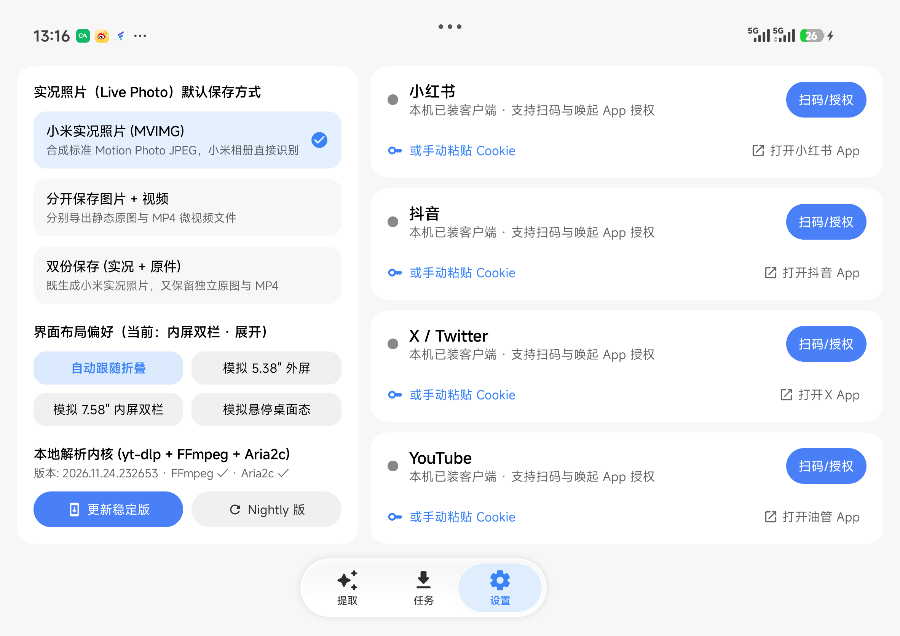

# 叠影提取 · FoldMedia

面向 **Xiaomi HyperOS 折叠屏设备**（为 Xiaomi 18 Fold 深度适配，同样支持常规 Android 13+ 手机与平板）打造的 **100% 端侧本地化**多平台媒体提取与小米实况照片（MVIMG）合成应用。

所有链接解析、WebView 鉴权、实况合成、音视频封装与相册写入均在手机本地完成，不依赖任何第三方中转服务端。

<p align="center">
  
  
</p>

## 核心特性

- **多平台端侧解析**
  - 支持 **小红书、抖音、X / Twitter、YouTube** 分享文案 / 口令 / 短链接清洗与多跳重定向展开（`LinkSanitizer`、`MediaExtractorRepository`）。
  - 结合本机 `WebViewBridgeExtractor`、`PlatformJsonParsers` 与内嵌本地引擎（`yt-dlp` + `FFmpeg` + `Aria2c`）完成图文、无水印视频与实况双流提取。
- **小米实况照片（MVIMG）原生合成**
  - 内置 `XiaomiMotionPhotoBuilder`（基于 Adobe XMP `xmpcore`），支持将静态原图与微视频合成为标准 Motion Photo JPEG 写入系统相册，小米相册可直接识别播放，同时支持「分开保存图片 + 视频」与「双份保存（实况 + 原件）」。
- **折叠屏三态自适应布局 & HyperOS 液态玻璃交互**
  - 基于 Jetpack WindowManager 实时感知折痕位置与窗口宽度，自动切换「5.38" 外屏单栏」「7.58" 内屏双栏」「悬停桌面态」，并在设置页提供形态模拟切换。
  - 基于 **Miuix**（`miuix-ui`、`miuix-glass`、`miuix-blur`）打造 AGSL 透明液态玻璃悬浮导航 Dock 与拖拽晶体透镜。
- **本地真实凭证管理（CookieVault）**
  - 仅在检测到平台真实会话 Cookie 时标记已登录，避免匿名访客 Cookie 误判；支持桌面端二维码扫码授权、唤起本机已安装客户端授权，以及本地解析内核版本在线切换与更新。

## 安装使用

前往 [Releases](https://github.com/D1a0y1bb/FoldMedia/releases) 页面下载对应安装包：

- **现代 Android 手机（含 Xiaomi 18 Fold / 骁龙 64 位设备推荐）**：下载 `FoldMedia-v*-arm64-v8a-release.apk`
- **多架构 / 模拟器通用版**：下载 `FoldMedia-v*-universal-release.apk`

## 从源码构建

### 环境要求

- **JDK 17**
- **Android SDK**：`compileSdk = 37`、`buildToolsVersion = "37.0.0"`、`minSdk = 33`、`targetSdk = 36`
- **Gradle Wrapper**：Gradle `9.3.1`（AGP `9.1.1`，Kotlin `2.4.21`）

### 运行单元测试与构建 Debug APK

```bash
./gradlew :app:testDebugUnitTest :app:assembleDebug
```

### 构建签名 Release APK

在项目根目录创建 `keystore.properties`（已被 `.gitignore` 忽略，切勿提交到版本库）：

```properties
storeFile=/path/to/your-release-key.jks
storePassword=your_store_password
keyAlias=your_key_alias
keyPassword=your_key_password
```

然后执行：

```bash
./gradlew :app:assembleRelease
```

构建产物位于 `app/build/outputs/apk/release/`。

## 开源协议与免责声明

本项目基于 [MIT License](LICENSE) 开源。  
应用仅提供端侧公开网页媒体解析与个人已获权收藏内容的本地格式整理能力；请严格遵守各内容平台的版权规定与服务条款，切勿用于未经授权的商业分发或侵权用途。
