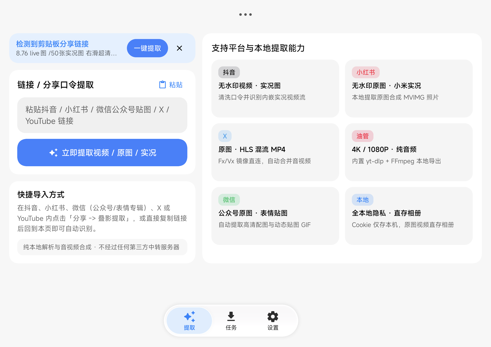
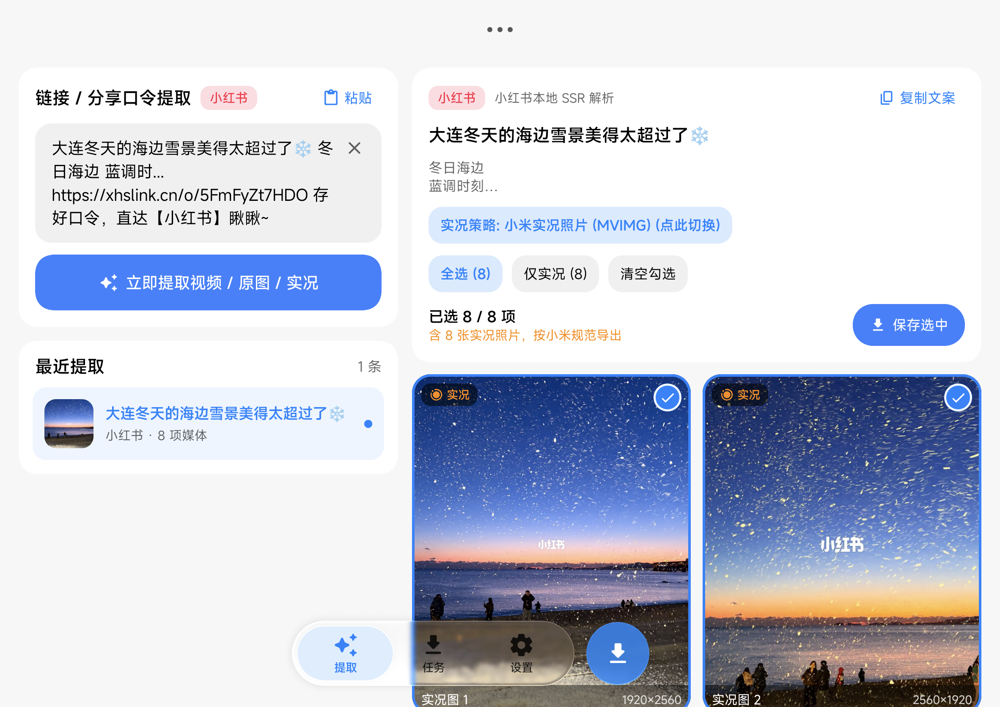
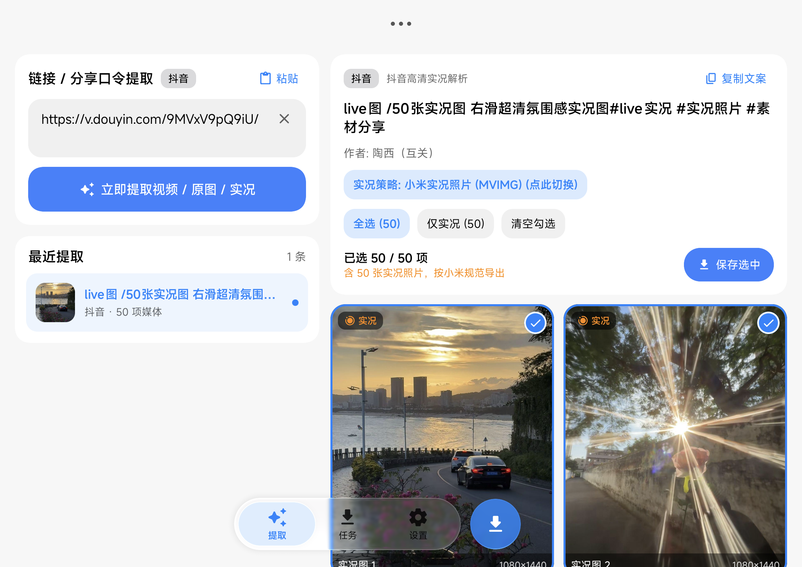
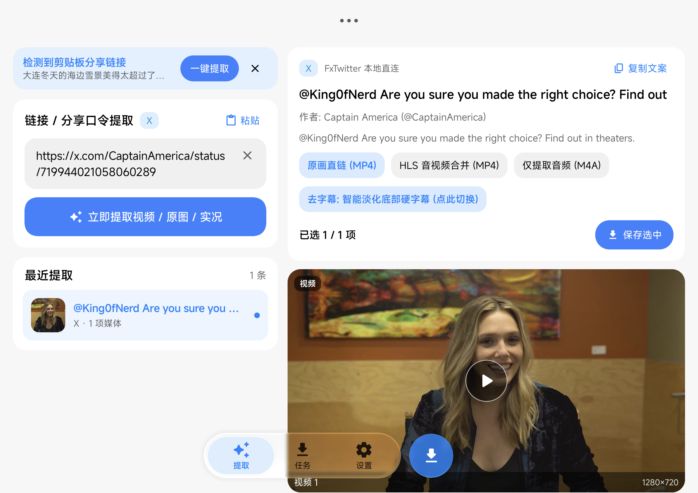
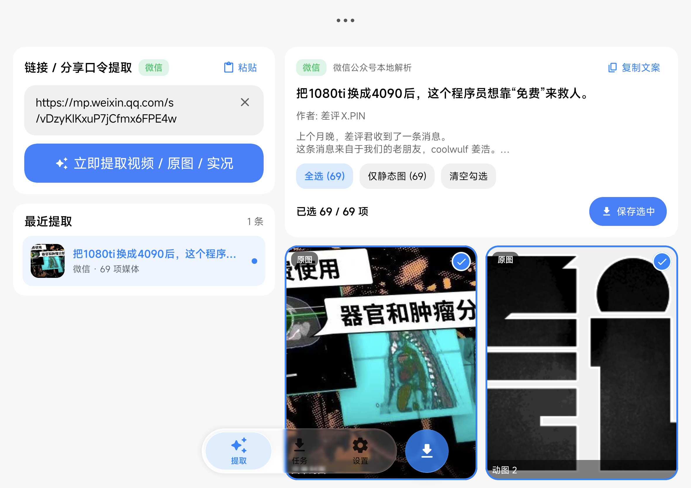
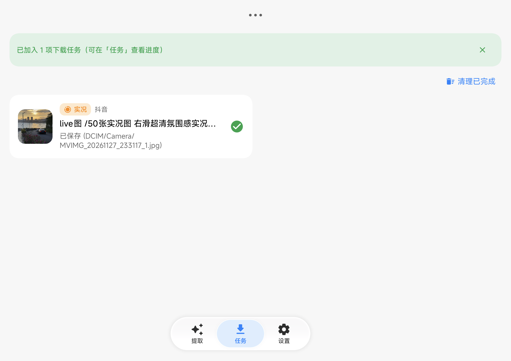

# 叠影提取 · FoldMedia

面向 **Xiaomi HyperOS 折叠屏设备**（为 Xiaomi 18 Fold 深度适配，同样支持常规 Android 13+ 手机与平板）打造的 **100% 端侧本地化**多平台媒体提取与小米实况照片（MVIMG）合成应用。

所有链接解析、WebView 鉴权、实况合成、音视频封装与相册写入均在手机本地完成，不依赖任何第三方中转服务端。

<p align="center">
  
  
</p>

## v1.0.2 升级亮点与实机截图

- **修复全新安装 R8 混淆崩溃（`pf0`）**：为 `org.apache.commons.compress` 与 `org.apache.commons.io` 补齐 ProGuard 规则，解决首次安装解压本地引擎报错。
- **小红书 `xhslink.cn` 免登录实况解析**：识别 `xhslink.cn` 短链与 `/login?redirectPath=...` 跳转参数，支持移动端 `noteData.data.noteData` 与 `H5_DTL` 高清图/实况双流提取，无需登录即可保存小米 `MVIMG`。
- **抖音登录体验增强**：登录页补全 `WebChromeClient`（运行期授予人脸验证相机权限、弹窗接管与文件选择器）、`browser_fallback_url` 回退与刷新/返回操作。
- **新增 FFmpeg「去视频字幕」能力**：支持「关闭（原画直出）」「清除软字幕轨」「智能淡化底部硬字幕（`delogo`）」「裁切底部字幕区」四种本地处理策略。
- **应用内自动检查更新与一键升级**：启动自动检测 GitHub Releases 新版本并在设置页提供手动检查入口，匹配对应架构 APK 下载并通过系统安装器直接升级。

### v1.0.1 基础升级回顾
- **微信支持**：支持微信公众号高清配图/封面/动图 GIF 与表情贴图专辑提取。
- **抖音实况深度提取**：支持桌面端 `self.__pace_f` 图集内嵌实况视频流与小米 `MVIMG` 合成。
- **X 提取与混流 / APK 瘦身**：修复长时间卡顿、支持 FxTwitter 无登录敏感内容与 FFmpeg `.m3u8` 混流 MP4；启用 R8 压缩使 `arm64-v8a` 体积降至约 **61 MB**。

<p align="center">
  
  
</p>
<p align="center">
  
  
</p>
<p align="center">
  
</p>

## 核心特性

- **多平台端侧解析**
  - 支持 **抖音、小红书、微信（公众号文章 / 表情贴图专辑）、X / Twitter、YouTube** 分享文案 / 口令 / 短链接清洗与多跳重定向展开（`LinkSanitizer`、`MediaExtractorRepository`）。
  - 结合本机 `WebViewBridgeExtractor`、`PlatformJsonParsers`（支持桌面 SSR `self.__pace_f` 与公众号贴图/正文字段识别）、Fx/Vx & Syndication 多路热备以及内嵌本地引擎（`yt-dlp` + `FFmpeg`）完成无水印视频、原图、GIF 动图与 X HLS（`.m3u8`）音视频混流导出。
- **小米实况照片（MVIMG）原生合成**
  - 内置 `XiaomiMotionPhotoBuilder`（纯 Kotlin 轻量 Motion Photo XMP 封装），支持将静态原图与抖音 / 小红书实况微视频合成为标准 Motion Photo JPEG 写入系统相册，小米相册可直接识别播放，同时支持「分开保存图片 + 视频」与「双份保存（实况 + 原件）」。
- **折叠屏三态自适应布局 & HyperOS 液态玻璃交互**
  - 基于 Jetpack WindowManager 实时感知折痕位置与窗口宽度，自动切换「5.38" 外屏单栏」「7.58" 内屏双栏」「悬停桌面态」，并在设置页提供形态模拟切换。
  - 基于 **Miuix**（`miuix-ui`、`miuix-glass`、`miuix-blur`）打造 AGSL 透明液态玻璃悬浮导航 Dock 与拖拽晶体透镜。
- **本地真实凭证管理（CookieVault）**
  - 仅在检测到平台真实会话 Cookie 时标记已登录，避免匿名访客 Cookie 误判；支持桌面端二维码扫码授权、唤起本机已安装客户端授权，以及本地解析内核版本在线切换与更新。

## 安装使用

前往 [Releases](https://github.com/D1a0y1bb/FoldMedia/releases) 页面下载对应安装包：

- **现代 Android 手机（含 Xiaomi 18 Fold / 骁龙 64 位设备推荐）**：下载 `FoldMedia-v*-arm64-v8a-release.apk`（约 61 MB）
- **多架构 / 模拟器通用版**：下载 `FoldMedia-v*-universal-release.apk`（约 199 MB）

## 从源码构建

### 环境要求

- **JDK 17**
- **Android SDK**：`compileSdk = 37`、`buildToolsVersion = "37.0.0"`、`minSdk = 33`、`targetSdk = 36`
- **Gradle Wrapper**：Gradle `9.3.1`（AGP `9.1.1`，Kotlin `2.4.21`）

### 运行单元测试与构建 Debug APK

```bash
./gradlew :app:testDebugUnitTest :app:assembleDebug
```

### 构建签名 Release APK

在项目根目录创建 `keystore.properties`（已被 `.gitignore` 忽略，切勿提交到版本库）：

```properties
storeFile=/path/to/your-release-key.jks
storePassword=your_store_password
keyAlias=your_key_alias
keyPassword=your_key_password
```

然后执行：

```bash
./gradlew :app:assembleRelease
```

构建产物位于 `app/build/outputs/apk/release/`。

## 开源协议与免责声明

本项目基于 [MIT License](LICENSE) 开源。  
应用仅提供端侧公开网页媒体解析与个人已获权收藏内容的本地格式整理能力；请严格遵守各内容平台的版权规定与服务条款，切勿用于未经授权的商业分发或侵权用途。
